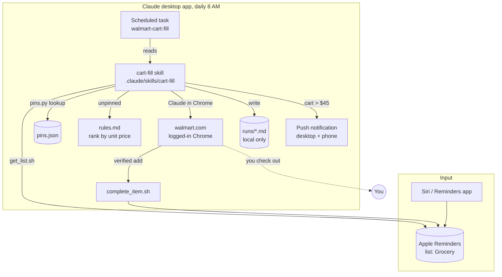

# walmart-shopper

Fills a walmart.com cart from an Apple Reminders grocery list. Say "Hey Siri, add eggs to my Grocery list", and a daily job adds the cheapest matching item for store delivery, marks the reminder done, and pings your phone when the cart passes a threshold. You still check out by hand.

## Architecture



## How it works

1. **List intake.** Items are read from the Reminders list named `Grocery` on the Mac (`scripts/get_list.sh`). Siri, the Reminders app, or the command line can add to it.
2. **Pins.** Each item is checked against `pins.json`. A pinned item maps straight to a Walmart item ID, so the exact product is added with no search.
3. **Search.** Unpinned items are searched on walmart.com and ranked by `rules.md`: delivery from the local store only, cheapest unit price, single pack, size cap, plain meaning of the word.
4. **Add and verify.** The item is added through Claude in Chrome (your logged-in browser). The add is verified against the cart badge and quantity stepper before the reminder is marked complete (`scripts/complete_item.sh`).
5. **Log and ping.** A run log is written to `runs/` (local only, gitignored). If the cart total is over $45, a push notification goes to the Claude desktop and mobile app.

## Requirements

- macOS with the Claude desktop app (Code tab) and the Claude in Chrome extension
- Chrome logged into walmart.com with a delivery store selected
- Apple Reminders with a list named `Grocery`, synced via iCloud
- Python 3.9+
- Terminal and the Claude app allowed to control Reminders (macOS prompts on first run)

## Setup

```bash
git clone https://github.com/masteroflink/walmart-shopper.git
```

Confirm the list reads:

```bash
scripts/get_list.sh
```

Register the daily job. Open the repo in the Claude desktop app (Code tab) and run:

```
/setup-schedule
```

That creates (or updates) the `walmart-cart-fill` task: 8 AM local, pointing at this clone's `.claude/skills/cart-fill/SKILL.md`, which holds the full procedure and is versioned here. The task runs while the app is open; a missed 8 AM run fires on next launch. Click "Run now" once from the Scheduled sidebar to pre-approve browser permissions.

The job runs on Claude Sonnet 5.5, set in `.claude/settings.json`. Change `model` there to trade cost for capability.

## Usage

Add items any of these ways:

- "Hey Siri, add milk to my Grocery list"
- The Reminders app on any Apple device
- `osascript -e 'tell application "Reminders" to tell list "Grocery" to make new reminder with properties {name:"milk"}'`

Pin a product so it's always chosen for a list word:

```
/pin https://www.walmart.com/ip/Great-Value-Milk-2-Reduced-Fat-Half-Gallon-64-fl-oz-Jug/10450119 milk
```

Or without the skill:

```bash
python3 scripts/pins.py add 10450119 --key milk --alias "2% milk" --alias "reduced fat milk"
python3 scripts/pins.py lookup "Milk"
python3 scripts/pins.py list
```

Lookup is exact after normalization: lowercase, punctuation stripped, leading counts dropped, last word singularized. "Eggs", "egg", and "2 dozen eggs" all hit the key `egg`. "egg whites" does not.

## Project layout

| Path | Purpose |
|---|---|
| `scripts/get_list.sh` | Print open items from the Grocery list, one per line |
| `scripts/complete_item.sh` | Mark one item completed after a verified add |
| `scripts/pins.py` | Add, look up, and list pinned Walmart item IDs |
| `pins.json` | Pinned items, keyed by normalized list word |
| `rules.md` | Ranking rules for unpinned items |
| `.claude/skills/cart-fill/` | `/cart-fill` skill: the full daily procedure the scheduled job runs |
| `.claude/skills/setup-schedule/` | `/setup-schedule` skill: registers the daily task for this clone |
| `.claude/settings.json` | Project model (`claude-sonnet-5-5`) |
| `.claude/skills/pin/` | `/pin` skill for pinning a product to a list word |
| `runs/` | Per-run logs (gitignored) |
| `test_list.txt` | Sample list used for the first prototype |

## Notes

- iPhone-to-Mac Reminders sync stalls when iCloud storage is full. Items added on the phone won't be seen until space is freed.
- Add-to-cart clicks by accessibility ref fail silently on walmart.com. The job scrolls to the product title, then clicks the Add button by screen coordinate and verifies.
- The job never checks out, never changes the store, and never adds anything not on the list.
